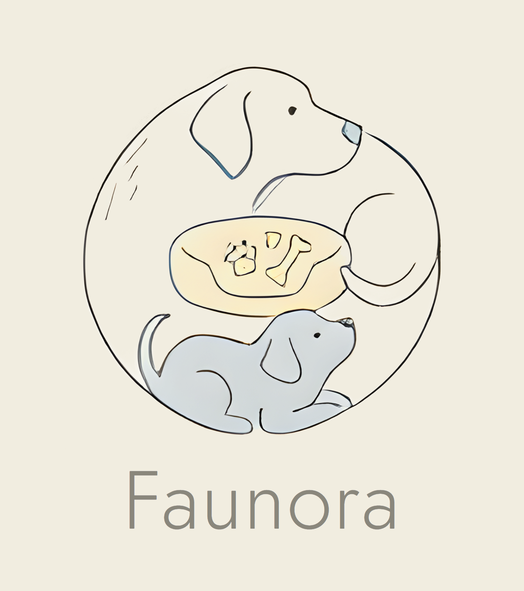

# Faunora — site V2

**Diet consultation with professional pet nutritionists, and homemade meals cooked in our own kitchen.**

A Venture Creation project at BINUS University, 2026.

- **Website (V2, the 3D house):** https://kaynederon-maker.github.io/faunora/
- **Film (3 min), "Long Walks":** [video/Faunora_Ad_3min.mp4](video/Faunora_Ad_3min.mp4)
- **Film (90 s), "From the land to the bowl":** [video/Faunora_Ad_90s.mp4](video/Faunora_Ad_90s.mp4)

> **V2** replaces the scrolling page with one interactive 3D house. The previous site is kept at the
> [`v1.0`](../../tree/v1.0) tag; this release is tagged `v2.0`.

## The website (V2)

The page is a single fixed stage: a 3D cutaway house, with one room in focus at a time. Scroll, swipe, use the
arrow keys, the nav or the dots on the house to move between rooms. Each room's button opens the full content.

| Room | What it opens |
|---|---|
| Consultation room | Nutritionist profiles, plans and the booking form (prototype, no backend) |
| Kitchen | Farm-to-bowl story and the six-step catering timeline |
| Shop | 26 products across meals, snacks, toys and fashion, with an animated add-to-bag |
| Lounge | Client reviews |
| Study | About us and the "founded in five minutes" history |
| Rooftop | The team |

- **Chat:** a care desk answers before you book, and your assigned nutritionist after. Replies are simulated, but
  the feeding maths is real (daily calories and grams from the pet's weight), it knows which foods are safe or
  toxic, and it sends emergencies to a vet. It understands common Indonesian words.
- **Mock call screen** after booking (no audio or backend).
- **Works on phones** in portrait and landscape, with swipe navigation.
- Background music with a mute button in the top right.

## What's here

| Path | Contents |
|---|---|
| `index.html`, `style.css`, `stage.css` | The page, component styles, and the stage / cards / sheets layout |
| `app.bundle.js` | Built from `js/` by `build.sh` (three.js included). Do not edit by hand |
| `js/app.js`, `js/world.js` | Tour logic (stops, sheets, input) and the three.js renderer and camera |
| `js/scene/` | The house, modelled in code (`kit.js`, `props.js`, `house.js`), and the character loader (`cast.js`) |
| `js/shop.js`, `js/care.js`, `js/bot.js`, `js/data.js` | Shop and bag; booking, chat and call; the simulated nutritionist; site data |
| `assets/models/cast.glb` | Pets, people and the 3D wordmark, sculpted in Blender by `tools/make_characters.py` |
| `assets/` | Photos, logo and the site's background score |
| `vendor/` | three.js r170 and the loaders it needs |
| `video/` | The 3-minute film "Long Walks" and the 90-second film "From the land to the bowl" (1080p) |
| [`docs/Robust Design Factors_Faunora.docx`](docs/Robust%20Design%20Factors_Faunora.docx) | GSLC: Robust Design Factor Identification (P-diagram, control and noise factors, L9 experiment, FMEA) |
| [`docs/Prototype Testing Report and Feedback Grid_Faunora.docx`](docs/Prototype%20Testing%20Report%20and%20Feedback%20Grid_Faunora.docx) | GSLC: Customer discovery prototype testing report and Feedback Grid |

### Run it locally

Double-click `preview.bat` (needs Python); it serves the folder at http://127.0.0.1:8765/. Opening `index.html`
straight from disk shows the house without its characters, because browsers block the model download on
`file://` pages.

### Rebuild

    sh build.sh                 # after editing anything in js/
    node js/bot.test.mjs        # checks the chat bot's answers
    blender -b --factory-startup -P tools/make_characters.py    # after editing the characters

## Team

| Name | Student ID | Role |
|---|---|---|
| Siegfried Vesakha Setiawan | 2802405882 | CEO |
| Kayne Deron Kusnadi | 2802405150 | COO |
| Angelino Delvin | 2802526271 | CFO |
| Andi Siti Maryam Shaskirana | 2802462500 | CMO |

## Credits and disclosure

Photography, team illustrations, the film, its characters, the voiceover and the music were generated with AI tools (ComfyUI with SDXL, Google Flow, Google Gemini and Google AI Studio). The V2 website, its 3D house and the Blender character script were built with Claude Code. The people and reviews shown are fictional, and booking and checkout are simulated, since this is a student prototype.
